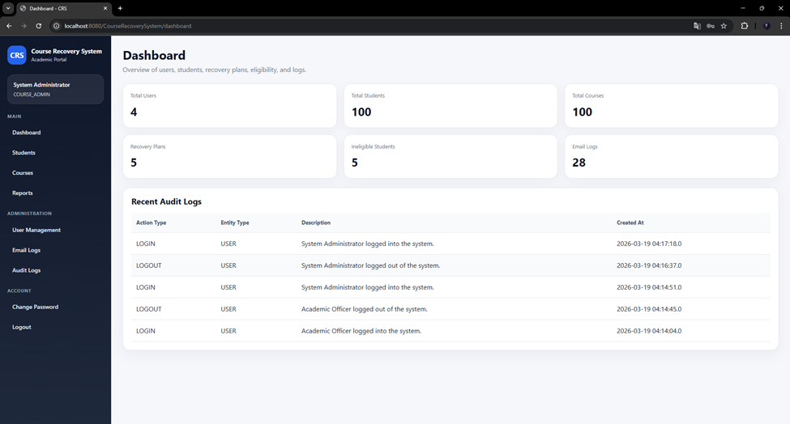
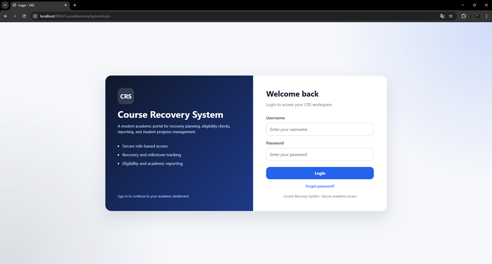
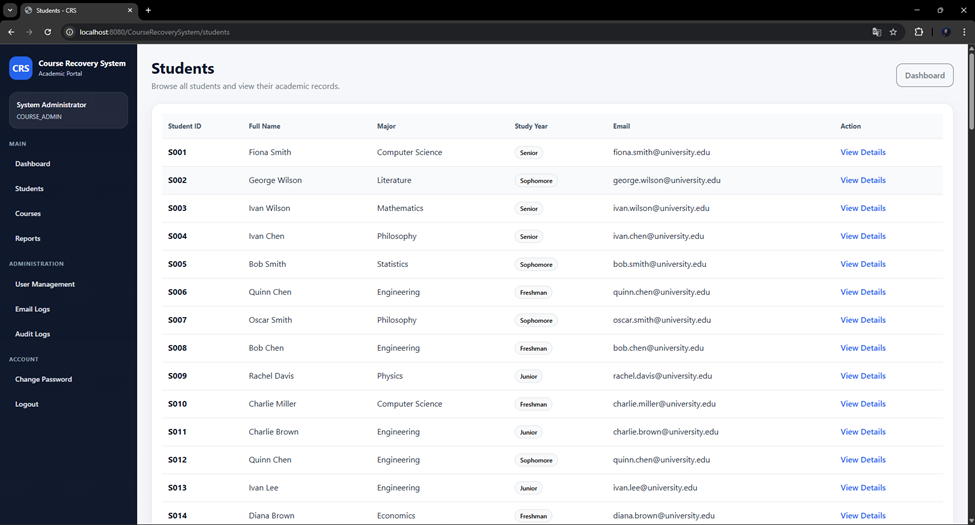
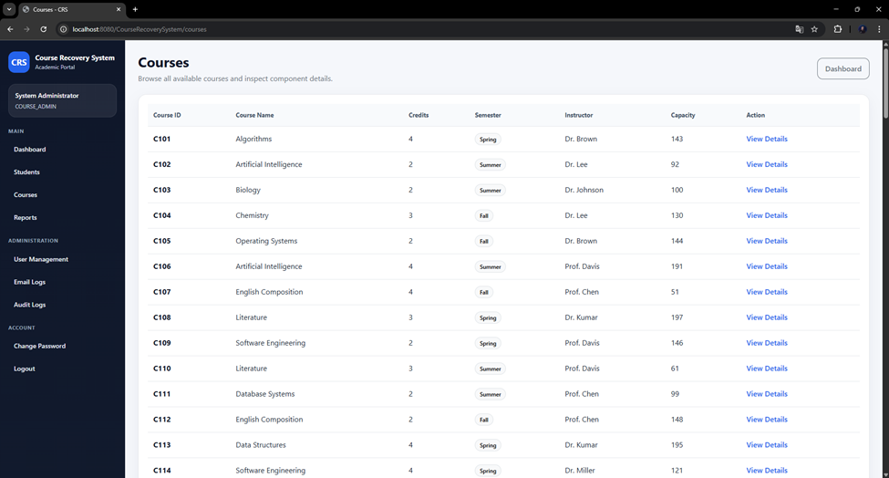
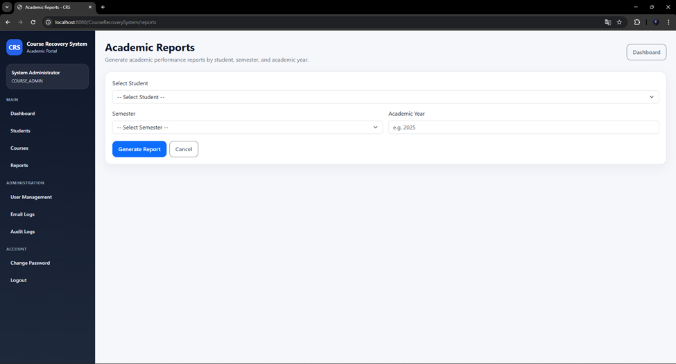
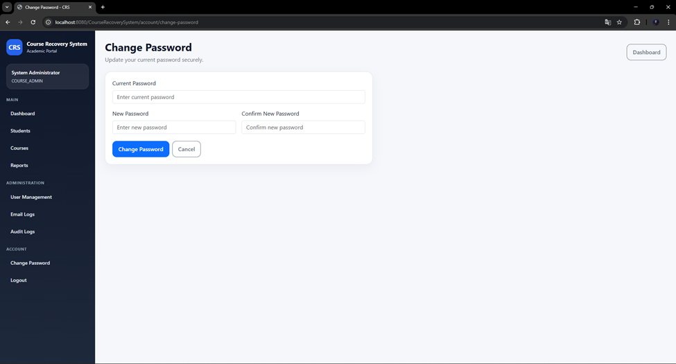
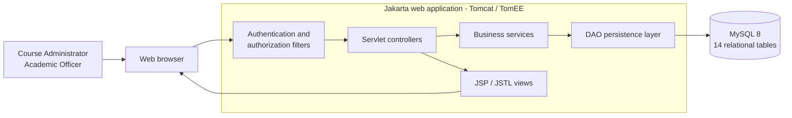

<div align="center">

# Course Recovery System

### A role-aware academic operations portal for structured course recovery

[](https://jakarta.ee/)
[](https://jakarta.ee/specifications/servlet/)
[](https://www.mysql.com/)
[](https://tomcat.apache.org/)
[](#system-architecture)

**A server-rendered Java web application that helps academic teams identify at-risk students, evaluate recovery eligibility, plan interventions, monitor milestones, and preserve an auditable record of decisions.**

[Product tour](#application-showcase) · [Architecture](#system-architecture) · [Capabilities](#core-capabilities) · [Local setup](#run-locally) · [Security](#security-and-limitations)

</div>



## Product Overview

Course Recovery System (CRS) centralises the operational work required when students need structured academic recovery. Course administrators maintain users and governance records, while academic officers evaluate eligibility, approve enrolment decisions, create recovery plans, define milestones, record progress, and generate academic reports.

The application is implemented as a layered Jakarta Servlet/JSP monolith backed by MySQL. It deliberately keeps request handling, business rules, persistence, and presentation in separate packages so the system remains understandable and maintainable without the operational overhead of distributed services.

## Core Capabilities

| Capability | What the system provides |
| --- | --- |
| **Authentication and accounts** | Session-based login, logout, password changes, reset requests, administrative resets, and account activation controls. |
| **Role-based access** | Separate Course Administrator and Academic Officer permissions enforced through servlet filters. |
| **Student records** | Searchable student listings, academic profiles, course results, and component-level performance history. |
| **Course structure** | Course catalogues, credit values, semesters, instructors, capacity, and weighted assessment components. |
| **Eligibility evaluation** | CGPA calculation from latest attempts, failed-course counting, eligibility decisions, remarks, and history. |
| **Recovery planning** | Recovery plans linked to failed results, recommendations, milestones, status tracking, and progress notes. |
| **Enrolment decisions** | Approval records connected to the latest eligibility evaluation and the responsible academic officer. |
| **Academic reporting** | Student, semester, and academic-year report generation with a printable report view. |
| **Operational traceability** | Audit logs, email logs, dashboard summaries, and recent-activity visibility. |
| **User administration** | User creation, editing, deactivation, role assignment, and password reset support. |

## Application Showcase

<table>
  <tr>
    <td width="50%"></td>
    <td width="50%"></td>
  </tr>
  <tr>
    <td align="center"><strong>Secure workspace entry</strong><br><sub>Focused authentication with a concise explanation of the academic workflow.</sub></td>
    <td align="center"><strong>Operational dashboard</strong><br><sub>Users, students, courses, recovery plans, eligibility, email activity, and audit events.</sub></td>
  </tr>
  <tr>
    <td width="50%"></td>
    <td width="50%"></td>
  </tr>
  <tr>
    <td align="center"><strong>Student records</strong><br><sub>Academic identity, programme, study year, and detailed performance access.</sub></td>
    <td align="center"><strong>Course catalogue</strong><br><sub>Credits, semester, instructor, capacity, and component detail navigation.</sub></td>
  </tr>
  <tr>
    <td width="50%"></td>
    <td width="50%"></td>
  </tr>
  <tr>
    <td align="center"><strong>Academic reporting</strong><br><sub>Student, semester, and academic-year report criteria with printable output.</sub></td>
    <td align="center"><strong>Account security</strong><br><sub>Authenticated password-change workflow within the user workspace.</sub></td>
  </tr>
</table>

## System Architecture

CRS uses a **layered, server-side MVC architecture** packaged as a single Java web application:



### Layer Responsibilities

| Layer | Responsibility |
| --- | --- |
| **Filters** | Protect authenticated routes and enforce role-specific access. |
| **Servlets** | Accept HTTP requests, validate inputs, coordinate workflows, and select views. |
| **Services** | Implement authentication, eligibility, reporting, recovery, dashboard, and audit rules. |
| **DAOs** | Execute parameterised JDBC operations and map relational data into domain models. |
| **Models** | Represent users, students, courses, results, recovery plans, milestones, and logs. |
| **JSP/JSTL views** | Render protected server-side pages and reusable interface fragments. |
| **MySQL** | Persist academic records, workflow state, account data, and operational history. |

## Roles and Access

### Course Administrator

- Manage users and account status
- Reset user passwords
- Review audit and email logs
- Access students, courses, reports, and dashboard summaries

### Academic Officer

- Evaluate student eligibility
- Review ineligible students
- Record enrolment decisions
- Create and maintain recovery plans
- Define milestones and record progress
- Generate academic reports

## Technology Stack

| Area | Technology |
| --- | --- |
| Language | Java |
| Web platform | Jakarta Servlet 6.0, JSP, JSTL |
| Application server | Apache Tomcat 10.1 or compatible TomEE runtime |
| Persistence | JDBC with DAO pattern |
| Database | MySQL 8 / InnoDB |
| Interface | Server-rendered HTML and custom CSS |
| Security | HTTP sessions, authentication filter, role authorisation filter, password hashing |
| Development | Eclipse-compatible web application structure, Git, GitHub |

## Verified Implementation Footprint

The repository currently contains:

| Component | Count |
| --- | ---: |
| Java source files | **90** |
| Servlet controllers | **36** |
| Business services | **12** |
| DAO classes | **17** |
| Domain models | **18** |
| JSP pages | **29** |
| Relational tables represented in SQL | **14** |
| Schema and seed scripts | **11** |
| Product screenshots | **6** |

These figures describe the committed implementation. The repository does not currently include an automated test suite or a Maven/Gradle build definition, so no automated test or build badge is claimed.

## Recovery Decision Model

Eligibility is calculated from the student's latest result for each course:

- Weighted CGPA is calculated using course credits.
- The latest attempt is selected when a course has multiple results.
- A student is eligible when CGPA is at least `2.00` and failed courses do not exceed `3`.
- Evaluations and enrolment decisions are persisted with the responsible user and timestamp.
- Recovery plans connect a student, course, failed result, recommendations, milestones, and progress history.

## Run Locally

### Prerequisites

- Java Development Kit compatible with Tomcat 10.1
- Apache Tomcat 10.1 or a compatible TomEE installation
- MySQL 8
- Eclipse IDE for Enterprise Java and Web Developers, or an equivalent Jakarta web tooling setup

### 1. Clone the repository

```bash
git clone https://github.com/ALMAFLEHI/CourseRecoverySystem.git
cd CourseRecoverySystem
```

### 2. Create the database

Run the schema scripts in this dependency order:

1. `database/schema/schema.sql`
2. `database/seed/student_results_tables.sql`
3. `database/schema/workflow_tables.sql`

Then load the required sample data from `database/seed/`, beginning with users, students, courses, and course components before result and workflow records.

### 3. Configure database access

Database credentials are read from environment variables and are not committed to source control:

```powershell
$env:CRS_DB_URL="jdbc:mysql://localhost:3306/crs_db?useSSL=false&serverTimezone=UTC"
$env:CRS_DB_USERNAME="root"
$env:CRS_DB_PASSWORD="<your-local-mysql-password>"
```

Configure these values in the environment used to launch Tomcat or in the Eclipse server launch configuration.

### 4. Configure runtime libraries

The web application expects the following libraries under `src/main/webapp/WEB-INF/lib`:

- MySQL Connector/J
- Jakarta Standard Tag Library implementation
- Jakarta Standard Tag Library API

### 5. Deploy

Import the project as a Jakarta/Java web application, attach a Tomcat 10.1 or compatible TomEE server, deploy the application, and open:

```text
http://localhost:8080/CourseRecoverySystem/login
```

The SQL seed files contain demonstration accounts for local evaluation only. Change seeded credentials before using the system in any shared environment.

## Project Structure

```text
CourseRecoverySystem/
├── src/main/java/com/crs/
│   ├── constants/           Route, role, and workflow constants
│   ├── dao/                 JDBC persistence operations
│   ├── filter/              Authentication and role enforcement
│   ├── model/               Academic and workflow domain models
│   ├── service/             Business rules and orchestration
│   ├── servlet/             HTTP request controllers
│   └── util/                Database and password utilities
├── src/main/webapp/
│   ├── assets/css/          Application styling
│   └── WEB-INF/
│       ├── lib/             Runtime libraries
│       └── views/           Protected JSP pages and fragments
├── database/
│   ├── schema/              Core and workflow schema
│   └── seed/                Demonstration academic records
├── screenshots/             Authentic application evidence
├── SECURITY.md              Security guidance and limitations
└── CITATION.cff             Citation metadata
```

## Security and Limitations

- Database credentials are loaded from environment variables.
- Protected JSP pages remain under `WEB-INF` and cannot be requested directly.
- Authentication and role restrictions are enforced by servlet filters.
- JDBC operations use prepared statements in the DAO layer.
- Seed accounts and academic records are synthetic demonstration data.
- The current password hashing utility uses a single SHA-256 digest. A production deployment should migrate to an adaptive password hashing algorithm such as Argon2id, BCrypt, or PBKDF2.
- The project does not currently include CSRF protection, automated tests, connection pooling, or a dependency-managed build file.
- The application is designed for academic demonstration and should receive a dedicated production-hardening review before real institutional use.

See [`SECURITY.md`](SECURITY.md) for responsible disclosure and deployment guidance.

## Roadmap

- Introduce Maven or Gradle dependency and build management
- Add unit, DAO integration, servlet, and end-to-end tests
- Replace SHA-256 password hashing with an adaptive password KDF
- Add CSRF tokens and stronger security headers
- Add connection pooling and environment-specific configuration
- Add pagination, filtering, and export options to large record views
- Add accessible charts for recovery outcomes and intervention trends

## Author

Designed and implemented by **Mohammed Abdulsalam Almaflehi**.

Repository maintained by [@ALMAFLEHI](https://github.com/ALMAFLEHI).

## Citation

Academic and portfolio references can use the metadata in [`CITATION.cff`](CITATION.cff).

## Usage Notice

No open-source licence is currently granted. The source is publicly visible for academic review and portfolio demonstration; all rights are reserved by the author.

<div align="center">

**Course Recovery System - structured academic intervention, from eligibility to measurable progress.**

</div>
